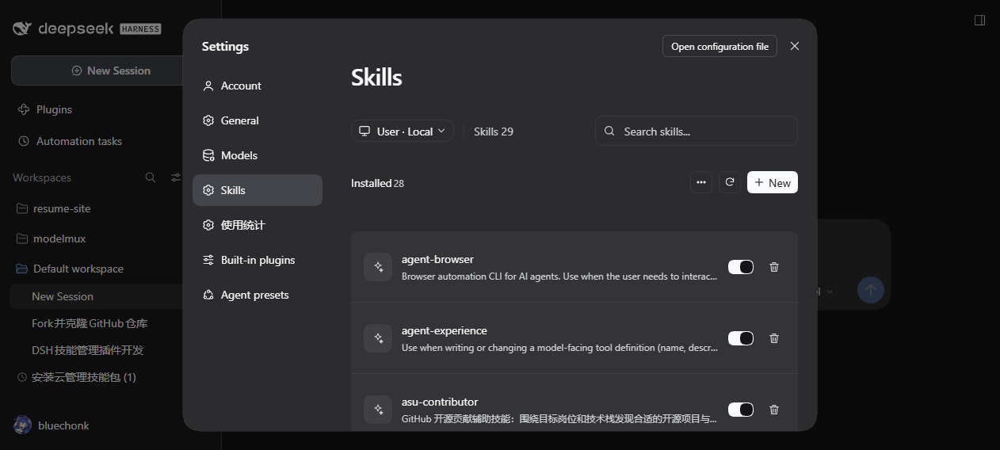
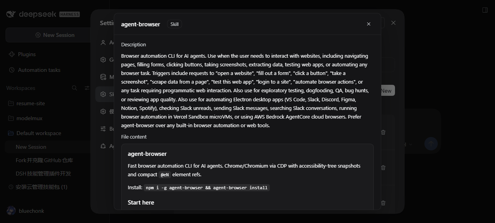
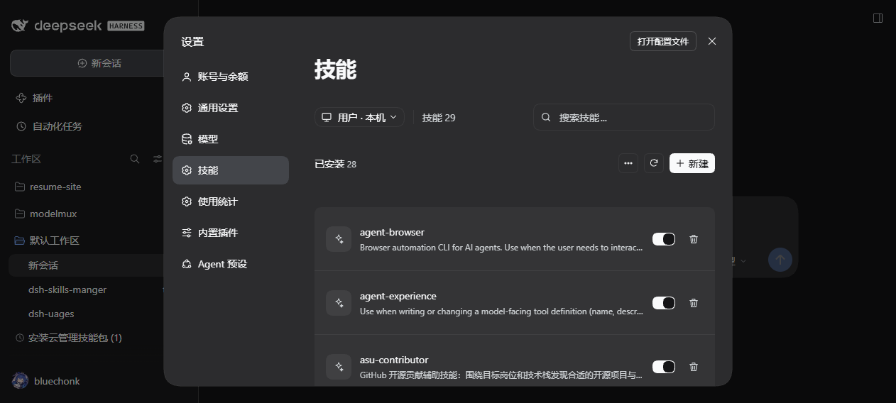

# dsh-skills-manager

[中文版](README.md) | **English**

A DeepSeek Harness plugin that adds a **Skills** section right below **Models** in the settings page, so every skill the Harness has actually loaded can be inspected and managed in one place — the global `~/.dsh/skills` and `~/.agents/skills` roots, plus project and workspace roots.


The plugin UI follows the host's language setting: switch it under "Settings → General → Language" and **no page reload is needed** — every label, button and message in this section switches immediately. The implementation uses the host's official i18n mechanism (`@deepseek-ai/dsh-client-locale`): the dictionary is registered with `ctx.locale.register` and the section registration declares its `locale` namespace, so the `t` reference the host injects changes with the language.

## Plugin identity

| Item | Value |
|---|---|
| npm package | `@bluechonk/dsh-skills-manager` |
| loader row id | `@bluechonk/dsh-skills-manager` |
| client module id | `@bluechonk/dsh-skills-manager` (must match the package name exactly) |
| settings section id | `dsh-skills-manager` (the key inside the `settings.section` slot) |
| section order | `order: 11` — directly below **Models** (order 10) |
| section title | 技能 / Skills |

Package name, loader row id and client module id all use the `@bluechonk` scope; that is the identifier to use when locating, enabling or removing the plugin in the plugin manager.

## Interface

| Area | Description |
|---|---|
| Scope dropdown | "User · Local" shows **only** the global `~/.dsh/skills`, the user-level `~/.agents/skills` and the preset built-ins; a "Workspaces" group lists every workspace, and picking one shows **only that workspace's** `<workspace>/.dsh/skills` and `<workspace>/.agents/skills` (global and user-level skills are not mixed in). Switching workspaces only rescans that workspace |
| Skill count | "Skills N" at the top is the number of skills visible in the current scope |
| Search | Filters live by name, description and path |
| Installed list | Name + description + enable switch + delete button; the switch writes `disable-model-invocation` (native DSH semantics), deletion is limited to managed roots |
| Built-in group | Skills registered at runtime or shipped inside a package are shown read-only, grouped by source |
| More menu | "Import" external agent skills |
| Detail dialog | Title + a "Skill" badge; description (the frontmatter `description`, rendered as Markdown); **file content** (the SKILL.md body, rendered as Markdown in a scrollable card, matching the Codex skill page); scope (Personal / project name / Built-in), status (Enabled / Disabled), and the file path (inline monospace path + copy icon) |


More menu and import dialog:


Scope dropdown:


Light theme (same layout, both themes checked):


English UI (the plugin follows the Harness language automatically):





Back to Chinese (same page, no reload):



## Design baseline

The interface is aligned with the **ZCode** "Settings → Skills" page: 30px/600 title, 896px centered content column, 12px borderless cards, 65px rows, 36px icon tiles, a 32×18 switch (on = foreground track with background thumb), and a 36px/12px/256px search field.

The measured values and the item-by-item comparison live in chapter 6 of [docs/设计与验证.md](docs/设计与验证.md); the ZCode reference captures are in [docs/reference/](docs/reference/).

## Skill roots covered

| Source | Path | DSH label | rank |
|---|---|---|---|
| Global DSH | `~/.dsh/skills` | `user-dsh` | 400 |
| Global Agents | `~/.agents/skills` | `user-agents` | 500 |
| Project DSH | `<projectRoot>/.dsh/skills` | `project-dsh` | 100 |
| Project Agents | `<projectRoot>/.agents/skills` | `project-agents` | 200 |
| Preset built-in | custom folder mounted by a preset | `custom` | 300 |
| Runtime | skills registered by plugins | `runtime` / `bundled` | — |

`<projectRoot>` is the nearest ancestor directory containing `.git`, falling back to the current working directory — the same rule as the official `@deepseek-ai/dsh-skill-filesystem` provider. Discovery is one level deep only: `<root>/<name>/SKILL.md` and `<root>/<name>.md`; dot-prefixed folders (such as `.system`) are skipped.

## Install, update, remove

```bash
# Install (the host resolves dependencies and writes the profile's bundle list)
plugin_manager install_bundle   # target = absolute path of this directory

# Enable / disable
plugin_manager set_plugin --target "@bluechonk/dsh-skills-manager" --enabled true

# Remove
plugin_manager remove_bundle --target "@bluechonk/dsh-skills-manager"
```

After installing, refresh the DSH page: "Skills" appears below "Models" in the settings navigation. The host half takes effect with the profile; the client artifact is hot-swapped by `dsh-client-hmr` through bundle fingerprint polling — press `Ctrl+F5` if the page has been open for a long time.

## API surface

The host half registers same-origin routes on `ctx.webServer` (all guarded by loopback + same-origin checks; write operations add method and body-size limits):

| Method | Path | Purpose |
|---|---|---|
| GET | `/dsh-skills-manager/state` | Skill list, root inventory, workspace list, totals |
| POST | `/dsh-skills-manager/body` | One skill's frontmatter, body and file list |
| POST | `/dsh-skills-manager/reveal` | Open the skill folder in the system file manager |
| POST | `/dsh-skills-manager/toggle` | Enable / disable (rewrites the frontmatter) |
| POST | `/dsh-skills-manager/remove` | Delete a skill under a managed root |
| POST | `/dsh-skills-manager/create` | Create a skill folder |
| POST | `/dsh-skills-manager/import` | Import from an external folder (symlink / copy) |
| GET | `/dsh-skills-manager/external` | Scan external agent skill folders |

Error responses carry a stable `code` (plus `params` for dynamic parts such as the skill name) so the client can render the message in the host's active language.

## Safety and boundaries

- Write targets are always resolved by the host from the skills it scanned, so **no arbitrary absolute path from the client is accepted**; a project target must come from a registered workspace.
- Deletion is limited to managed roots (`user-dsh` / `user-agents` / `project-dsh` / `project-agents`); a symlink is only unlinked, never its target; the target is checked against the managed root itself; the UI asks for confirmation and shows the path.
- Skills shipped inside official packages (under `node_modules`, detected through the real path) refuse modification and deletion so official packages are never damaged.
- The switch writes `disable-model-invocation`, which is native DSH semantics; `~/.agents/skills` is shared with other agent tools, so the same key also applies to Claude Code and friends. Files that are not UTF-8 (e.g. GBK) are refused rather than being corrupted.
- The plugin writes no persistent data of its own, only a `skills-manager.log` audit trail in the profile directory; it never reaches the network.

## Layout

```
dsh-skills-manager/
├─ package.json          # dsh.bundle.patch + dsh.client{platform:web}
├─ cordis.patch.yml      # loader insert row (id / name are @bluechonk/dsh-skills-manager)
├─ lib/index.js          # host half: root resolution, discovery, routes, write operations
├─ lib/roots.js          # root resolution and project-root detection (pure functions)
├─ lib/frontmatter.js    # frontmatter parsing and disable-model-invocation rewriting (pure functions)
├─ client/client.js      # client half: settings.section panel + detail/import/create dialogs
├─ locale/{en,zh}.json   # plugin manager metadata (meta.title / meta.description)
├─ icon.svg              # original icon
├─ docs/                 # design & verification notes, real captures, changelog
└─ test/                 # node:test unit tests
```

## Development

```bash
npm test          # node:test unit tests (58 cases: frontmatter / roots / discovery / HTTP layer / client pure functions / i18n)
npm run check     # syntax check (lib and client)
```

Design and verification details are in [docs/设计与验证.md](docs/设计与验证.md) (including the code review record); version history is in [CHANGELOG.md](CHANGELOG.md).

## Repository

- GitHub: <https://github.com/bluechonk/dsh-skills-manager>
- Plugin identity: package name / loader row id / client module id are all `@bluechonk/dsh-skills-manager`.
- Install with `plugin_manager install_bundle` (target = this directory); remove with `plugin_manager remove_bundle --target @bluechonk/dsh-skills-manager`.

## Credits and license

The directory discovery, frontmatter parsing and overall shape of this plugin were modelled on the community plugin [pengxiaozi/dsh-plugins](https://github.com/pengxiaozi/dsh-plugins) (`dsh-skill-panel`, MIT); scope switching and the write operations were added on top of its read-only capabilities.

MIT License — see [LICENSE](LICENSE).
