# dsh-skills-manager

[中文版](README.md) | **English**

A DeepSeek Harness plugin that adds a **Skills** panel to the sidebar, alongside **Plugins**, **Automations** and **Usage**, so every skill the Harness has actually loaded can be inspected and managed in one place — the global `~/.dsh/skills` and `~/.agents/skills` roots, plus project and workspace roots.

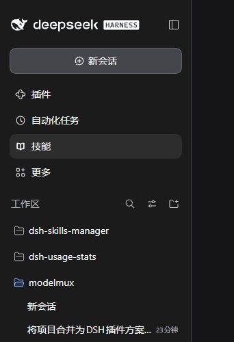

Clicking the row opens the full panel (scope switching, search, enable switches, detail dialog, import and create):

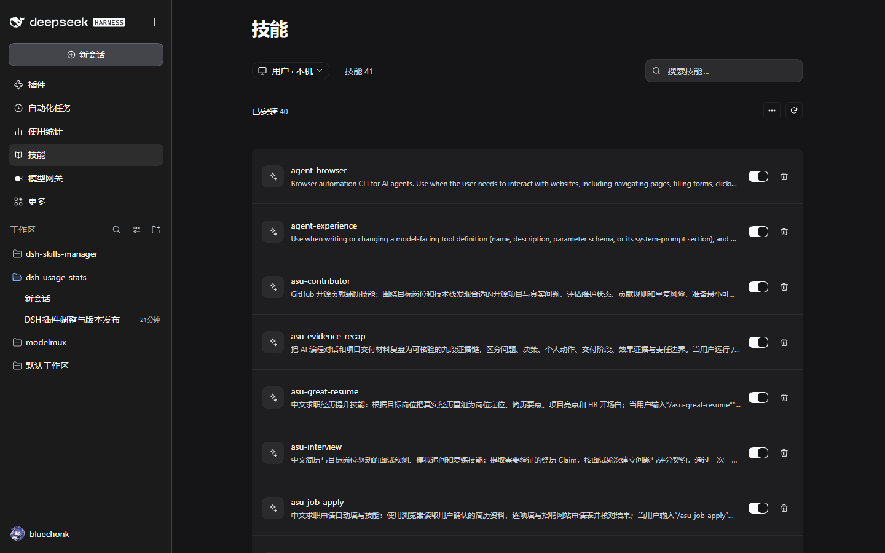

The plugin UI follows the host's language setting: switch it under "Settings → General → Language" and **no page reload is needed** — every label, button and message in this panel switches immediately. The implementation uses the host's official i18n mechanism (`@deepseek-ai/dsh-client-locale`): the dictionary is registered with `ctx.locale.register` and the component registration declares its `locale` namespace, so the `t` reference the host injects changes with the language.

## Plugin identity

| Item | Value |
|---|---|
| npm package | `@bluechonk/dsh-skills-manager` |
| loader row id | `@bluechonk/dsh-skills-manager` |
| client module id | `@bluechonk/dsh-skills-manager` (must match the package name exactly) |
| sidebar entry id | `skills-manager` (the `sidebar.panellist` row id, also the `main` keyed slot key) |
| navigation order | `order: 30` — after **Plugins** (0), **Automations** (10) and **Usage** (20) |
| navigation and panel title | 技能 / Skills |

Package name, loader row id and client module id all use the `@bluechonk` scope; that is the identifier to use when locating, enabling or removing the plugin in the plugin manager.

## Interface

| Area | Description |
|---|---|
| Scope dropdown | "User · Local" shows **only** the global `~/.dsh/skills`, the user-level `~/.agents/skills` and the preset built-ins; a "Workspaces" group lists every workspace, and picking one shows **only that workspace's** `<workspace>/.dsh/skills` and `<workspace>/.agents/skills` (global and user-level skills are not mixed in). Switching workspaces only rescans that workspace |
| Skill count | "Skills N" at the top is the number of skills visible in the current scope |
| Search | Filters live by name, description and path |
| Installed list | Name + description + enable switch + delete button; the switch writes both `disable-model-invocation: true` and `user-invocable: false` (DSH guards model loading and user invocation with these two keys separately) and also drops the legacy invocation keys DSH no longer accepts; deletion is limited to managed roots |
| Compatibility hint | DSH requires both `name` and `description` in the frontmatter and rejects legacy invocation keys — skills that break those rules are flagged "Not loaded by DSH" and their switch is disabled (the host ignores such files entirely) |
| Built-in group | Skills registered at runtime or shipped inside a package are shown read-only, grouped by source |
| More menu | "Import" external agent skills: sources cover Codex CLI / Claude Code / Gemini CLI / Qwen Code / ZCode (`~/.zcode/skills`); expand a source to see every skill with its name and description, pick individually or per source; a copy import fills in a missing description and removes legacy invocation keys |
| Detail dialog | Title + a "Skill" badge; description (the frontmatter `description`, rendered as Markdown); **file content** (the SKILL.md body, rendered as Markdown in a scrollable card, matching the Codex skill page); scope (Personal / project name / Built-in), status (Enabled / Disabled), and the file path (inline monospace path + copy icon) |
| Translation | On by default in the detail dialog: the **description and body** are translated into Chinese (the skill name is an identifier and is never translated), keeping Markdown structure and code blocks. Use "View original" to compare, or the "Translate" button in the title bar to turn it off. It reuses the host's `translator` service (the same Bing/Google channel as the reasoning translation); when `dsh-experimental-cot-translation-bundle` is not enabled it reports unavailability and falls back to the original text |

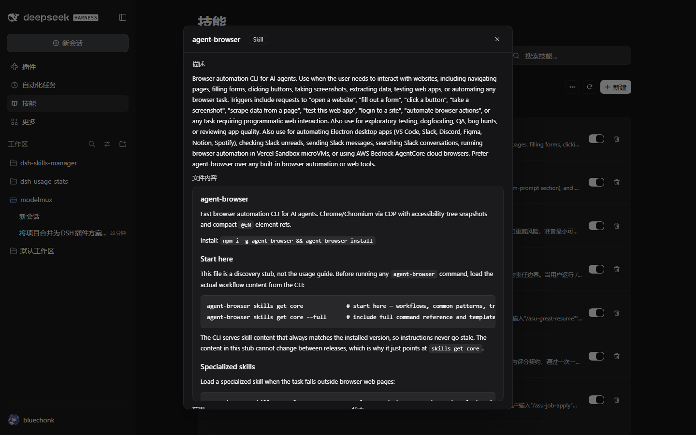

The same dialog translated (description and body in Chinese, switchable back to the original):

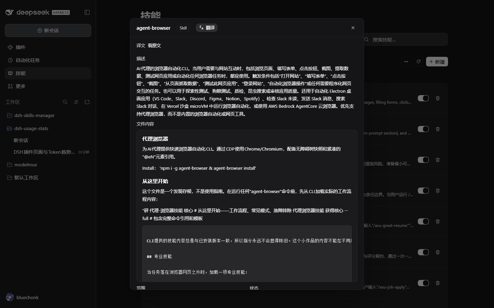

More menu and import dialog:

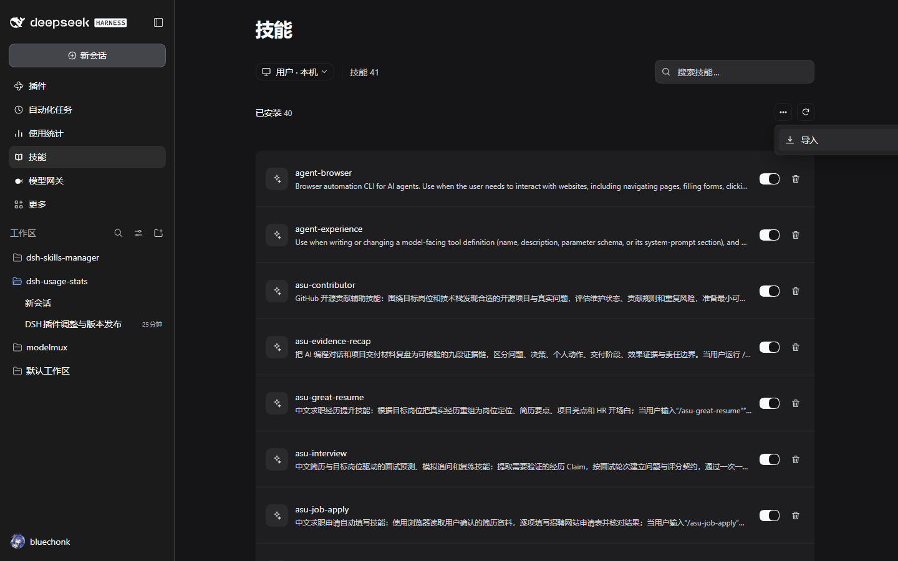

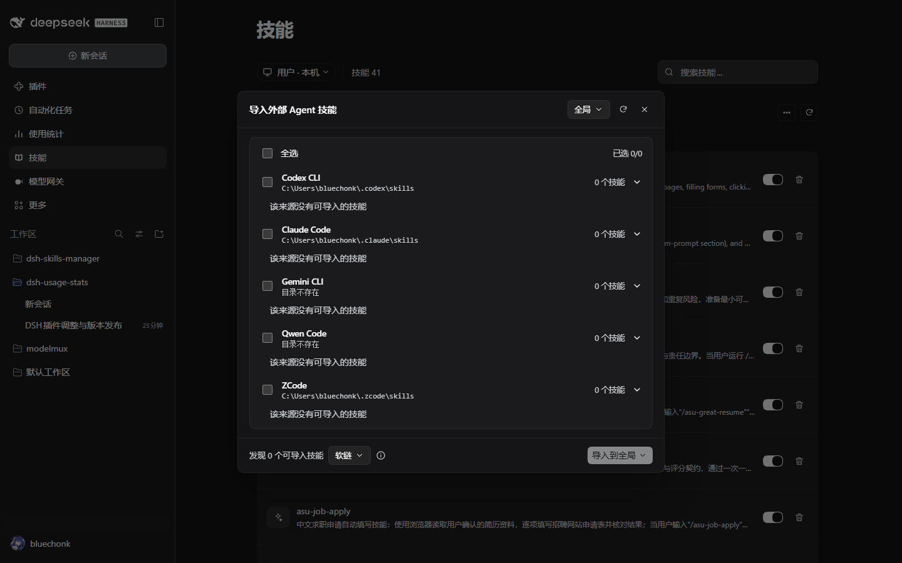

Scope dropdown:

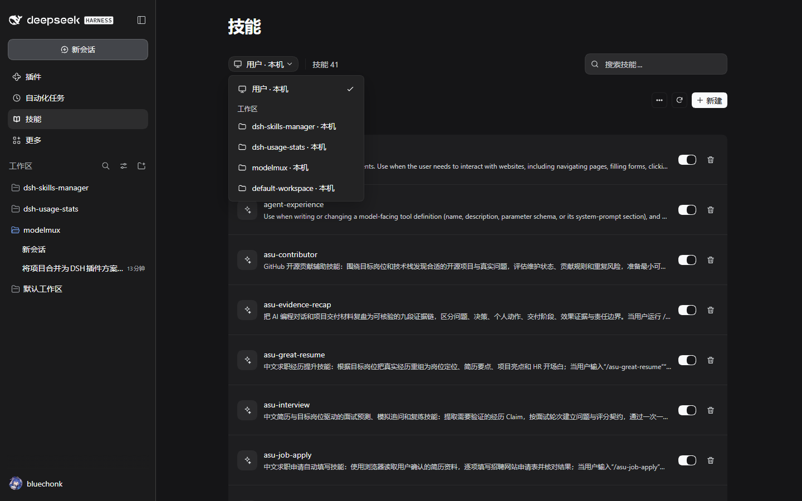

Light theme (same layout, both themes checked):

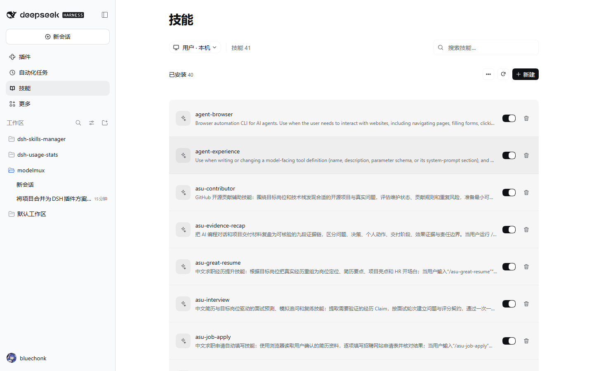

English UI (the plugin follows the Harness language automatically):

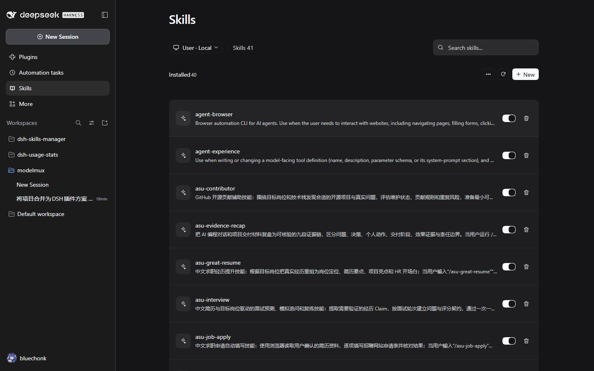

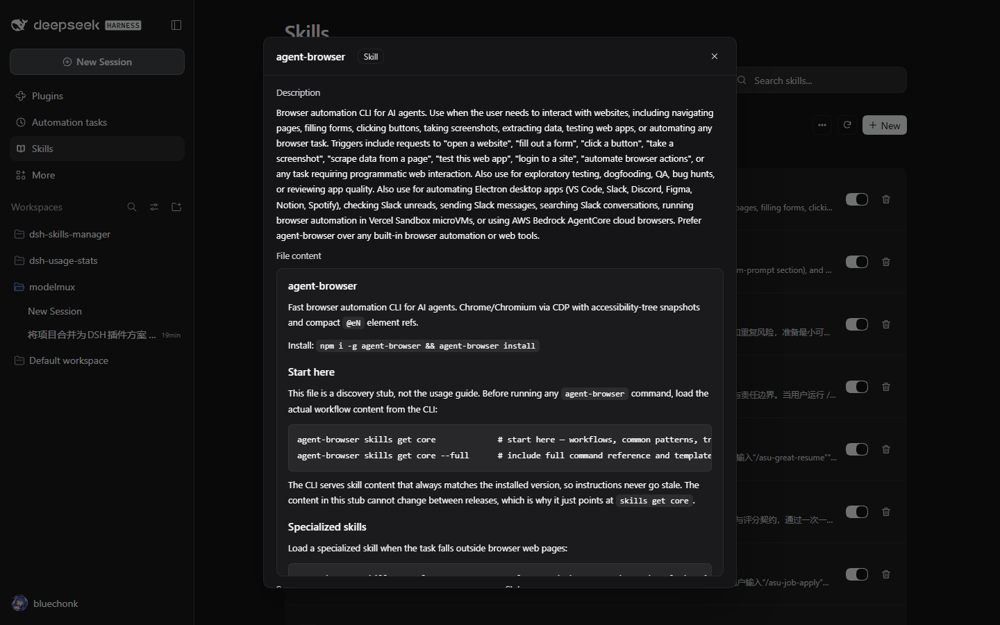

Back to Chinese (same page, no reload):

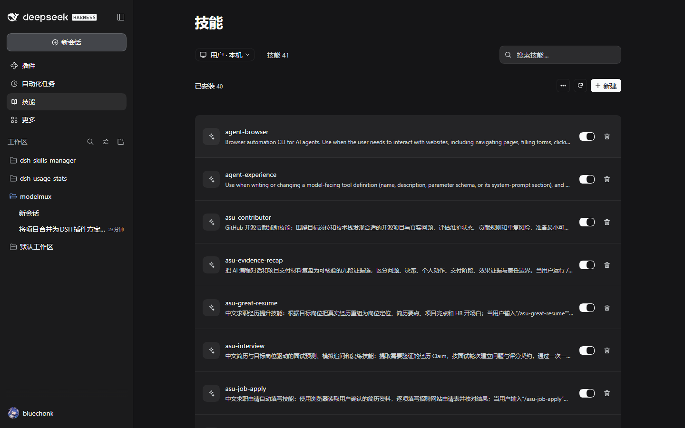

## Design baseline

The interface is aligned with the **ZCode** "Settings → Skills" page: 30px/600 title, 896px centered content column, 12px borderless cards, 65px rows, 36px icon tiles, a 32×18 switch (on = foreground track with background thumb), and a 36px/12px/256px search field.

The measured values and the item-by-item comparison live in chapter 6 of [docs/DESIGN-AND-VERIFICATION.md](docs/DESIGN-AND-VERIFICATION.md); the ZCode reference captures are in [docs/reference/](docs/reference/).

## Skill roots covered

| Source | Path | DSH label | rank |
|---|---|---|---|
| Global DSH | `~/.dsh/skills` | `user-dsh` | 400 |
| Global Agents | `~/.agents/skills` | `user-agents` | 500 |
| Project DSH | `<projectRoot>/.dsh/skills` | `project-dsh` | 100 |
| Project Agents | `<projectRoot>/.agents/skills` | `project-agents` | 200 |
| Preset built-in | custom folder mounted by a preset | `custom` | 300 |
| Runtime | skills registered by plugins | `runtime` / `bundled` | — |

`<projectRoot>` is the nearest ancestor directory containing `.git`, falling back to the current working directory — the same rule as the official `@deepseek-ai/dsh-skill-filesystem` provider. Discovery is one level deep only: `<root>/<name>/SKILL.md` and `<root>/<name>.md`; dot-prefixed folders (such as `.system`) are skipped.

## Install, update, remove

### Option 1: paste the GitHub link on the "Plugins" page (recommended)

The "Plugins" page has an "**+ Add plugin**" button whose dialog opens with "enter the package name, the **GitHub repository address** or a local directory path" — paste the repository link below and press Install; the UI labels it a "Git repository":

```
https://github.com/bluechonk/dsh-skills-manager
```

The install records the package in the profile's `dependencies` (as `github:bluechonk/dsh-skills-manager`). If the profile does not list it as a bundle yet (`dsh.profile.bundles`), add one line so the profile composes it:

```json
"dsh": { "profile": { "bundles": ["@bluechonk/dsh-skills-manager"] } }
```

Then restart DSH: "Skills" shows up in the sidebar below "Plugins", "Automations" and "Usage".

### Option 2: plugin market index (browse and install with one click)

This repository ships a **plugin market index** (`market-index.json`) that points at the repository's git source, pinned to a commit. Enable the market bundle once, then paste the link below into the index source field on DSH's "Settings → Plugins" page; the plugin shows up under the Discover tab and a single click installs it:

```
https://raw.githubusercontent.com/bluechonk/dsh-skills-manager/main/market-index.json
```

Enable the market bundle (one time; pick a version compatible with the running DSH — the host refuses an incompatible one and names the version it expects):

```bash
plugin_manager set_bundle --target "@deepseek-ai/dsh-experimental-plugin-market-bundle" --enabled true
```

### Option 3: tool and command line

```bash
# Tool (the plugin_manager tool is available in chat)
plugin_manager install_bundle --target "https://github.com/bluechonk/dsh-skills-manager"

# Command line (forwarded to pnpm inside the profile directory)
dsh plugin --profile desktop add "https://github.com/bluechonk/dsh-skills-manager"
```

The host's install-spec parser accepts a GitHub repository URL (it is a pnpm git dependency). After the install the host reads the package's `dsh.bundle.patch`, inserts the loader row, and records the package in the profile's `dsh.profile.bundles` and `dependencies`.

### Local development

```bash
# Install (the host resolves dependencies and writes the profile's bundle list)
plugin_manager install_bundle   # target = absolute path of this directory

# Enable / disable
plugin_manager set_plugin --target "@bluechonk/dsh-skills-manager" --enabled true

# Remove
plugin_manager remove_bundle --target "@bluechonk/dsh-skills-manager"
```

After installing, refresh the DSH page: "Skills" appears in the sidebar below "Plugins", "Automations" and "Usage". The host half takes effect with the profile; the client artifact is hot-swapped by `dsh-client-hmr` through bundle fingerprint polling — press `Ctrl+F5` if the page has been open for a long time.

## API surface

The host half registers same-origin routes on `ctx.webServer` (all guarded by loopback + same-origin checks; write operations add method and body-size limits):

| Method | Path | Purpose |
|---|---|---|
| GET | `/dsh-skills-manager/state` | Skill list, root inventory, workspace list, totals |
| POST | `/dsh-skills-manager/body` | One skill's frontmatter, body and file list |
| POST | `/dsh-skills-manager/reveal` | Open the skill folder in the system file manager |
| POST | `/dsh-skills-manager/toggle` | Enable / disable (rewrites the frontmatter) |
| POST | `/dsh-skills-manager/remove` | Delete a skill under a managed root |
| POST | `/dsh-skills-manager/create` | Create a skill folder |
| POST | `/dsh-skills-manager/import` | Import from an external folder (symlink / copy) |
| GET | `/dsh-skills-manager/external` | Scan external agent skill folders |

Error responses carry a stable `code` (plus `params` for dynamic parts such as the skill name) so the client can render the message in the host's active language.

## Safety and boundaries

- Write targets are always resolved by the host from the skills it scanned, so **no arbitrary absolute path from the client is accepted**; a project target must come from a registered workspace.
- Deletion is limited to managed roots (`user-dsh` / `user-agents` / `project-dsh` / `project-agents`); a symlink is only unlinked, never its target; the target is checked against the managed root itself; the UI asks for confirmation and shows the path.
- Skills shipped inside official packages (under `node_modules`, detected through the real path) refuse modification and deletion so official packages are never damaged.
- The switch writes both `disable-model-invocation: true` and `user-invocable: false`: DSH guards "the model loads it by itself" and "the user invokes it by name" with these two keys separately, so writing only the first leaves the skill usable in conversations (its content is still injected). `~/.agents/skills` is shared with other agent tools, so both keys also apply to Claude Code and friends. Files that are not UTF-8 (e.g. GBK) are refused rather than being corrupted.
- The plugin writes no persistent data of its own, only a `skills-manager.log` audit trail in the profile directory; it never reaches the network.

## Layout

```
dsh-skills-manager/
├─ package.json          # dsh.bundle.patch + dsh.client{platform:web}
├─ cordis.patch.yml      # loader insert row (id / name are @bluechonk/dsh-skills-manager)
├─ lib/index.js          # host half: root resolution, discovery, routes, write operations
├─ lib/roots.js          # root resolution and project-root detection (pure functions)
├─ lib/frontmatter.js    # frontmatter parsing and disable-model-invocation rewriting (pure functions)
├─ client/client.js      # client half: sidebar row + main panel + detail/import/create dialogs
├─ locale/{en,zh}.json   # plugin manager metadata (meta.title / meta.description)
├─ icon.svg              # original icon
├─ docs/                 # design & verification notes, real captures, changelog
└─ test/                 # node:test unit tests
```

## Development

```bash
npm test          # node:test unit tests (58 cases: frontmatter / roots / discovery / HTTP layer / client pure functions / i18n)
npm run check     # syntax check (lib and client)
```

Design and verification details are in [docs/DESIGN-AND-VERIFICATION.md](docs/DESIGN-AND-VERIFICATION.md) (including the code review record); version history is in [CHANGELOG.md](CHANGELOG.md).

## Repository

- GitHub: <https://github.com/bluechonk/dsh-skills-manager>
- Plugin identity: package name / loader row id / client module id are all `@bluechonk/dsh-skills-manager`.
- Install with `plugin_manager install_bundle` (target = this directory); remove with `plugin_manager remove_bundle --target @bluechonk/dsh-skills-manager`.

## Credits and license

The directory discovery, frontmatter parsing and overall shape of this plugin were modelled on the community plugin [pengxiaozi/dsh-plugins](https://github.com/pengxiaozi/dsh-plugins) (`dsh-skill-panel`, MIT); scope switching and the write operations were added on top of its read-only capabilities.

MIT License — see [LICENSE](LICENSE).
