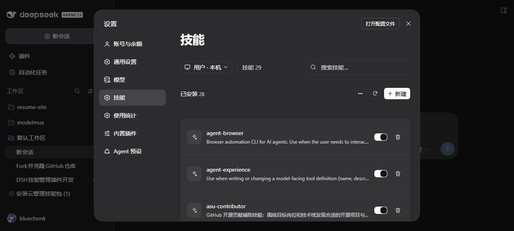
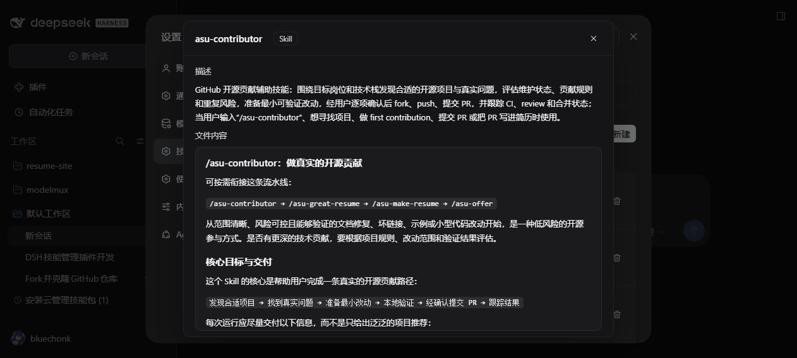
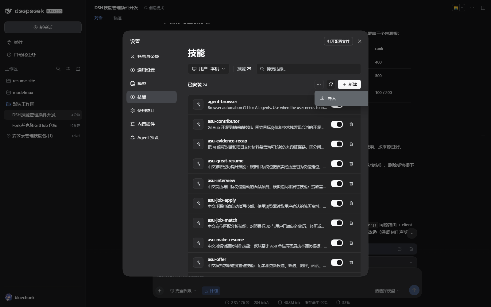
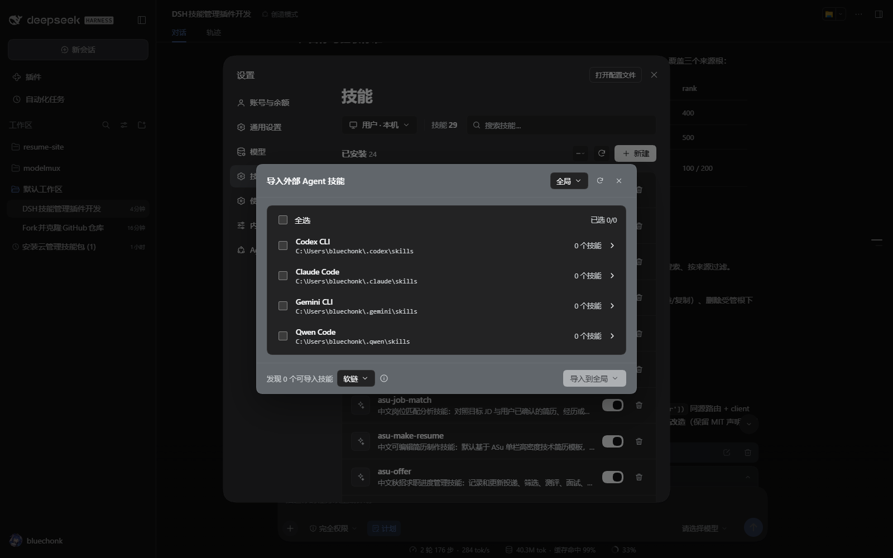
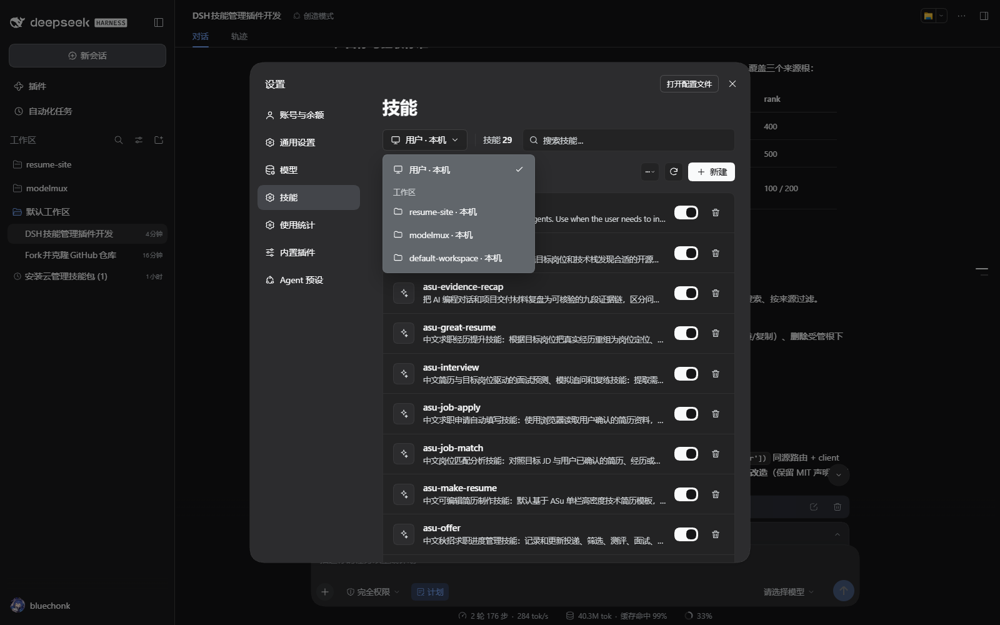
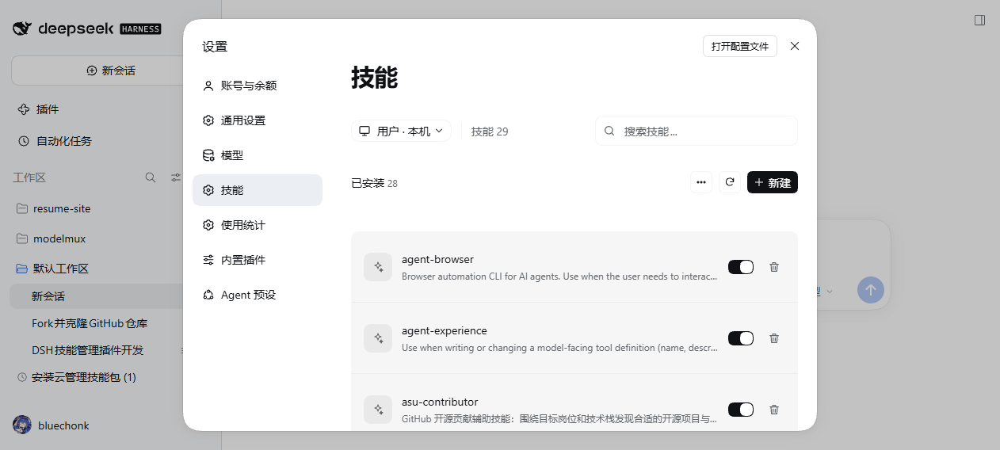

# dsh-skills-manager

DeepSeek Harness 插件：在**设置页「模型」正下方**新增「技能」分区，集中展示并管理当前实际加载的全部 skill —— 全局 `~/.dsh/skills`、全局 `~/.agents/skills`、以及项目/工作区技能。



## 插件标识

| 项 | 值 |
|---|---|
| npm 包名 | `@bluechonk/dsh-skills-manager` |
| loader 行 id | `@bluechonk/dsh-skills-manager` |
| client 模块 id | `@bluechonk/dsh-skills-manager`（必须与包名逐字一致） |
| 设置分区 id | `dsh-skills-manager`（`settings.section` 槽位内的分区键） |
| 分区顺序 | `order: 11` —— 紧贴「模型」（order 10）下方 |
| 分区标题 | 技能 / Skills Manager |

包名、loader 行 id、client 模块 id 三者统一使用 `@bluechonk` scope，插件管理器里定位、启用与卸载都以此为准。

## 界面

| 区域 | 说明 |
|---|---|
| 作用域下拉 | 「用户 · 本机」查看全局技能；「工作区」分组列出各工作区，切到某个工作区即查看该项目的技能根 |
| 技能计数 | 顶部「技能 N」为当前作用域可见的技能总数 |
| 搜索 | 按名称、描述、路径实时过滤 |
| 已安装列表 | 名称 + 描述 + 启用开关 + 删除按钮；开关写 `disable-model-invocation`（DSH 原生语义），删除只允许落在受管根之下 |
| 内置分组 | 运行时注册与随包内置的技能只读展示，按来源分组 |
| 更多菜单 | 「导入」外部 Agent 技能 |
| 详情弹窗 | 标题 +「Skill」徽章；描述（frontmatter 的 `description`，Markdown 渲染）；**文件内容**（SKILL.md 正文，Markdown 渲染的滚动卡片，形态对齐 Codex 技能页）；范围（个人 / 项目名 / 内置）、状态（已启用 / 已禁用）、文件路径（行内等宽路径 + 复制图标） |



更多菜单与导入弹窗：





作用域下拉：



浅色主题（同一套布局，深浅两版都已核对）：



## 设计基准

界面按本机 **ZCode**「设置 → 技能」页对齐：标题 30px/600、内容列 896px 居中、卡片 12px 无描边、行高 65px、图标块 36px、开关 32×18（开=前景色轨 + 背景色钮）、搜索框 36px/12px/256px。
实测参数与逐项对照见 [docs/设计与验证.md](docs/设计与验证.md) 第六章，ZCode 取材截图见 [docs/reference/](docs/reference/)。

## 覆盖的技能根

| 来源 | 路径 | DSH 标签 | rank |
|---|---|---|---|
| 全局 DSH | `~/.dsh/skills` | `user-dsh` | 400 |
| 全局 Agents | `~/.agents/skills` | `user-agents` | 500 |
| 项目 DSH | `<projectRoot>/.dsh/skills` | `project-dsh` | 100 |
| 项目 Agents | `<projectRoot>/.agents/skills` | `project-agents` | 200 |
| 预设内置 | preset 挂载的自定义目录 | `custom` | 300 |
| 运行时 | 插件注册的内置技能 | `runtime` / `bundled` | — |

`<projectRoot>` 取含 `.git` 的最近祖先目录，没有则取当前工作目录 —— 与官方提供方 `@deepseek-ai/dsh-skill-filesystem` 的规则一致。目录扫描只认一层：`<root>/<name>/SKILL.md` 与 `<root>/<name>.md`，`.` 开头的目录（如 `.system`）跳过。

## 安装、更新、卸载

```bash
# 安装（宿主负责解析依赖并写入 profile 的 bundles 列表）
plugin_manager install_bundle   # target = 本目录绝对路径

# 启用 / 停用
plugin_manager set_plugin --target "@bluechonk/dsh-skills-manager" --enabled true

# 卸载
plugin_manager remove_bundle --target "@bluechonk/dsh-skills-manager"
```

安装后刷新 DSH 页面，设置页导航里「技能」出现在「模型」下方。宿主半随 profile 生效，客户端产物由 `dsh-client-hmr` 的 bundle 指纹轮询热替换；页面长时间未刷新时手动 `Ctrl+F5` 即可。

## 数据通道

宿主半在 `ctx.webServer` 上注册同源路由（全部带回环 + 同源守卫，写操作另有方法与体积限制）：

| 方法 | 路径 | 用途 |
|---|---|---|
| GET | `/dsh-skills-manager/state` | 技能列表、根清单、工作区列表、统计 |
| POST | `/dsh-skills-manager/body` | 单个技能的 frontmatter、正文、文件清单 |
| POST | `/dsh-skills-manager/reveal` | 在系统文件管理器中打开技能目录 |
| POST | `/dsh-skills-manager/toggle` | 启用 / 禁用（改写 frontmatter） |
| POST | `/dsh-skills-manager/remove` | 删除受管根下的技能 |
| POST | `/dsh-skills-manager/create` | 新建技能目录 |
| POST | `/dsh-skills-manager/import` | 从外部目录导入（软链 / 复制） |
| GET | `/dsh-skills-manager/external` | 外部 Agent 技能目录扫描 |

## 安全与边界

- 写操作的目标一律由宿主按「已扫描到的技能」反查得到，**不接受客户端传入的任意绝对路径**；项目落点只认已登记工作区。
- 删除仅限受管根（`user-dsh` / `user-agents` / `project-dsh` / `project-agents`）；软链只删链接不删源；删除前校验目标不等于受管根本身；界面上有二次确认并列出路径。
- 官方包内置技能（`node_modules` 内，按真实路径判定）拒绝改写与删除，避免破坏官方包。
- 启停写的是 `disable-model-invocation`，这是 DSH 原生语义；`~/.agents/skills` 与其他 Agent 工具共享，该键对 Claude Code 等同样生效。非 UTF-8（如 GBK）编码的文件会被拒绝改写，避免内容被写成乱码。
- 插件不写任何持久化数据，仅在 profile 目录留一份 `skills-manager.log` 审计日志；不联网、不上传。

## 目录结构

```
dsh-skills-manager/
├─ package.json          # dsh.bundle.patch + dsh.client{platform:web}
├─ cordis.patch.yml      # loader 插入行（id / name 均为 @bluechonk/dsh-skills-manager）
├─ lib/index.js          # host 半：根解析、扫描、路由、写操作
├─ lib/roots.js          # 根解析与项目根探测（纯函数）
├─ lib/frontmatter.js    # frontmatter 解析与 disable-model-invocation 改写（纯函数）
├─ client/client.js      # client 半：settings.section 面板 + 详情/导入/新建弹窗
├─ locale/{en,zh}.json   # 插件管理器元数据（meta.title / meta.description）
├─ icon.svg              # 原创图标
├─ docs/                 # 设计与验证记录、实机截图、变更记录
└─ test/                 # node:test 纯函数单测
```

## 开发

```bash
npm test          # node:test 单测（52 项：frontmatter / 根解析 / 目录扫描 / HTTP 层 / 客户端纯函数）
npm run check     # 语法检查（lib 与 client）
```

设计与验证细节见 [docs/设计与验证.md](docs/设计与验证.md)（含代码评审与修复记录），版本变更见 [CHANGELOG.md](CHANGELOG.md)。

## 仓库

- GitHub：<https://github.com/bluechonk/dsh-skills-manager>
- 插件标识：包名 / loader 行 id / client 模块 id 统一为 `@bluechonk/dsh-skills-manager`。
- 安装：`plugin_manager install_bundle`，target 指向本目录；卸载：`plugin_manager remove_bundle --target @bluechonk/dsh-skills-manager`。

## 致谢与许可

本插件的目录扫描、frontmatter 解析与整体形态参考了社区插件 [pengxiaozi/dsh-plugins](https://github.com/pengxiaozi/dsh-plugins) 的 `dsh-skill-panel`（MIT），并在其只读能力之上补齐了范围切换与写操作。

MIT License，见 [LICENSE](LICENSE)。
